# Pulse — Virtual Clothing Shop

**Pulse** is a multi-component academic virtual-clothing-shop platform that connects a Unity 3D store, a Unity Android garment-capture application, a React merchant portal, a Node.js/Express API, MongoDB, and Python-based computer-vision and regression experiments.

The project explores a practical alternative to generating a complete garment mesh from photographs: it maps captured garment images to **UV textures on existing UMA-compatible clothing models** and delivers catalog changes to the virtual store in real time. It also investigates avatar body-measurement estimation and an optional animated virtual assistant. PIFuHD is discussed in the academic research, **not implemented as an executable garment-generation pipeline**.

## Academic Context and Project Background

The original **VCS — Virtual Clothing Shop** was developed at **[Politecnico di Bari](https://www.poliba.it/en/ingegneria-informatica-e-dellautomazione)** as part of the **Bachelor's Degree in Computer and Automation Engineering**, for the *Software Engineering and Web Fundamentals* course (**Software Engineering module**, Academic Year **2022–2023**), through a university project undertaken in collaboration with [Accenture](https://www.accenture.com/).

The system was subsequently extended as **Pulse** at **[Politecnico di Bari](https://www.poliba.it/en/laurea-magistrale-ingegneria-informatica)** as part of the **Master's Degree in Computer Engineering**, **Artificial Intelligence and Data Science** curriculum, for the *Software Architecture and Pattern Design* and *Statistical and Mathematical Methods for Artificial Intelligence* courses (Academic Year **2023–2024** for both). These stages share a codebase but have distinct contributors and technological emphases. The Accenture collaboration concerns the original VCS project, not an asserted formal partnership for every subsequent Pulse feature.

## Preview

The following screenshots illustrate selected representative features of the application and do not constitute an exhaustive overview of its interface.

The screenshots below document the academic VCS and Pulse interfaces, including the later garment-capture and AI extensions. Some interface details reflect the original academic versions.

### VCS — Virtual Clothing Shop

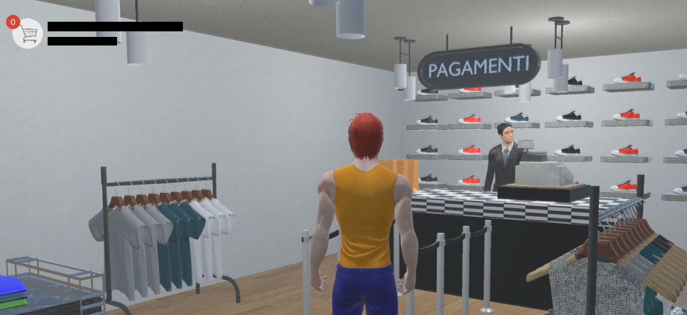

*Virtual store environment from the original VCS project.*

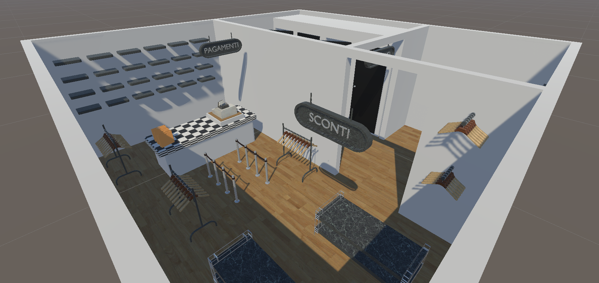

*Early 3D modeling of the store before decorative elements and final texturing (bachelor's thesis, Figure 2.5).*

<p align="center">
  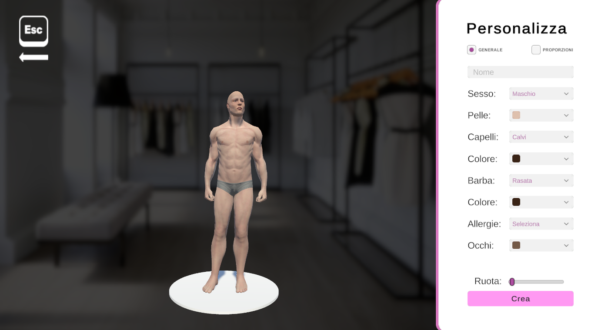
  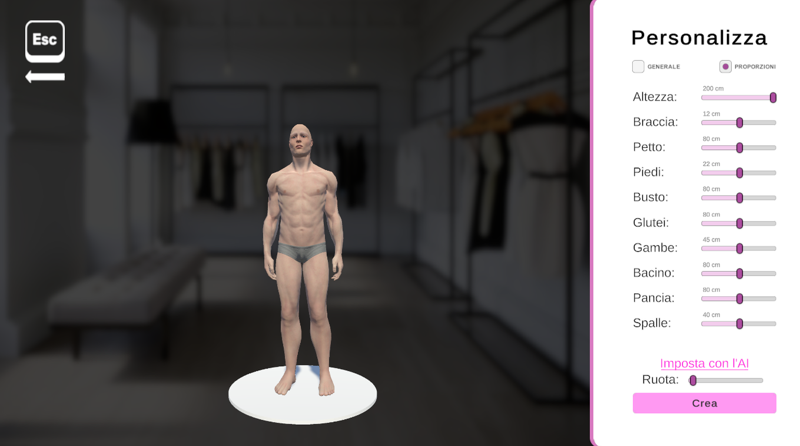
</p>
*Avatar appearance and body-proportion customization.*

<p align="center">
  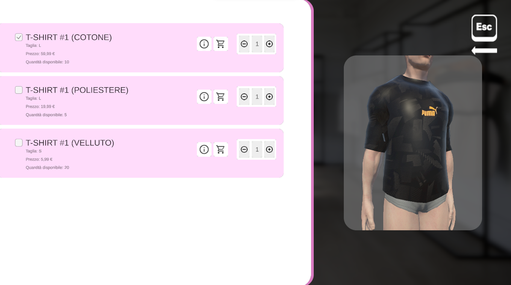
  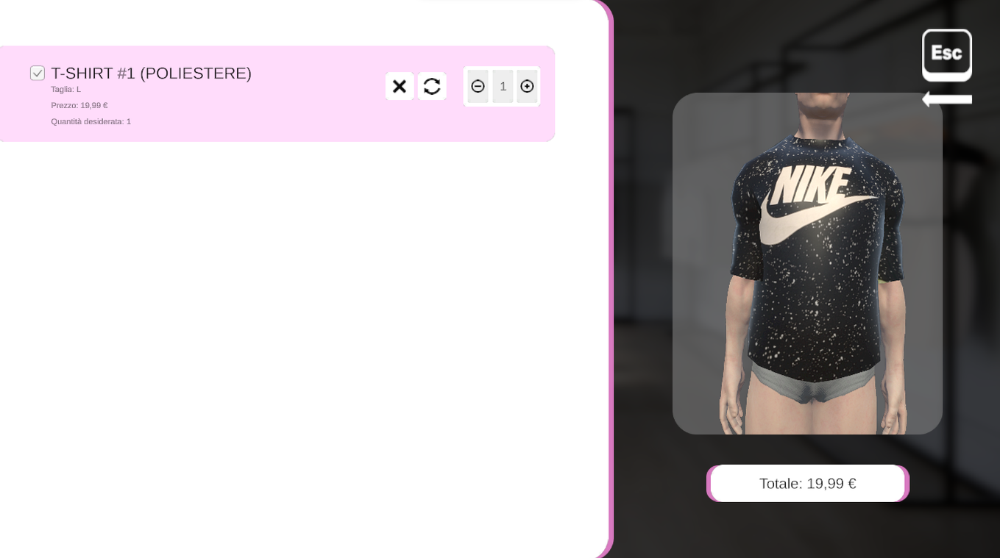
</p>

*Clothing catalog and shopping cart.*

<p align="center">
  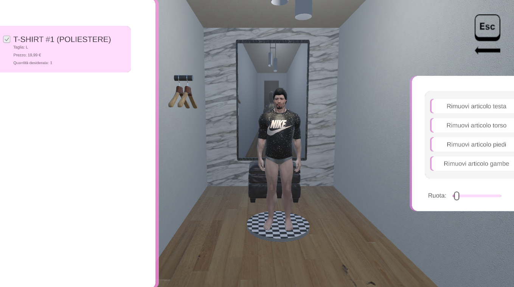
</p>

*Virtual fitting room.*

### Pulse — Web Portal

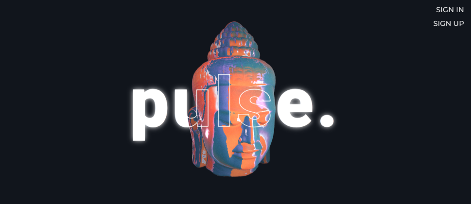

*Web portal home.*

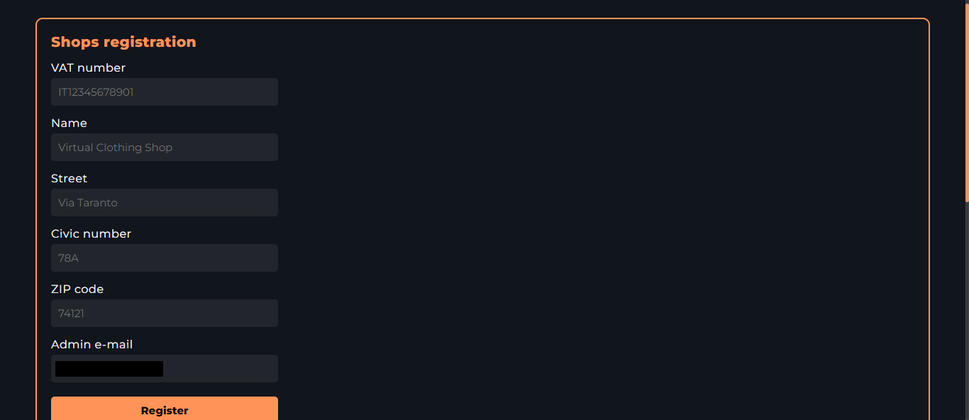

*Global administrator interface for registering stores (academic report, Figure 3.10; example form values).*

<p align="center">
  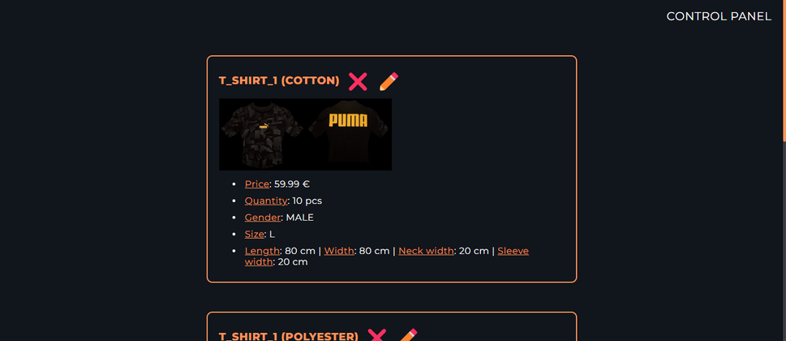
  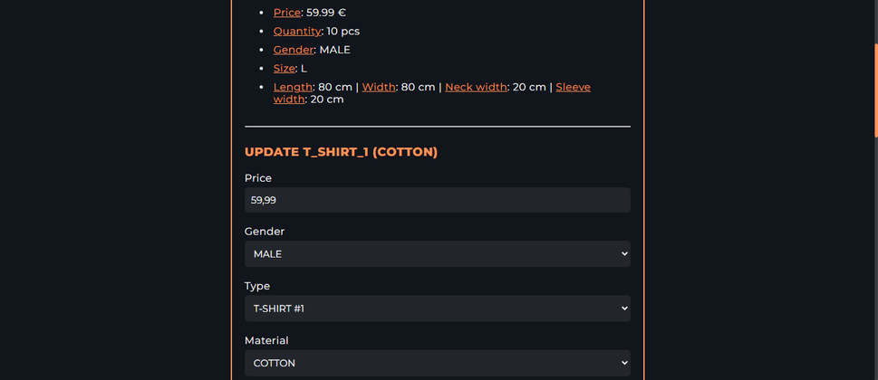
</p>

*Merchant clothing management and garment editing.*

### Pulse — Android Garment Capture

<p align="center">
  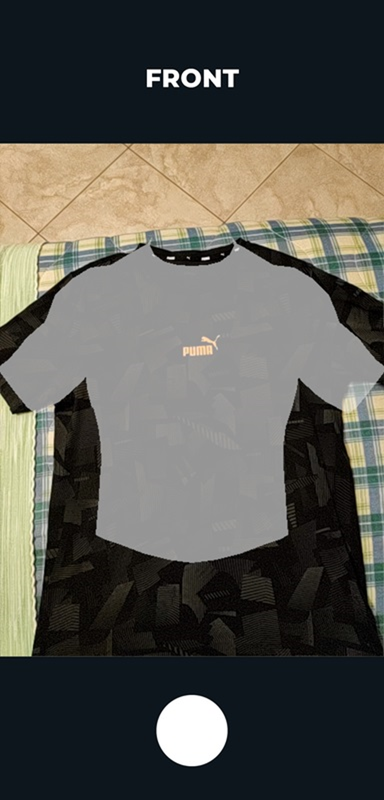
  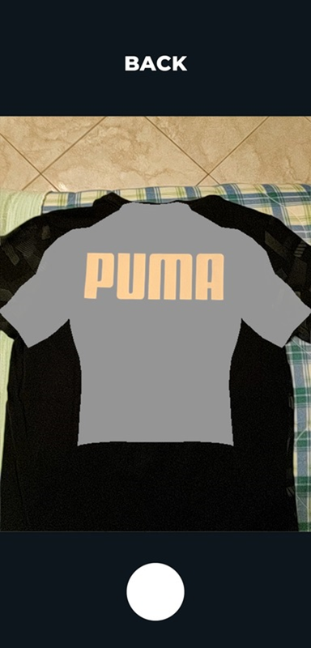
  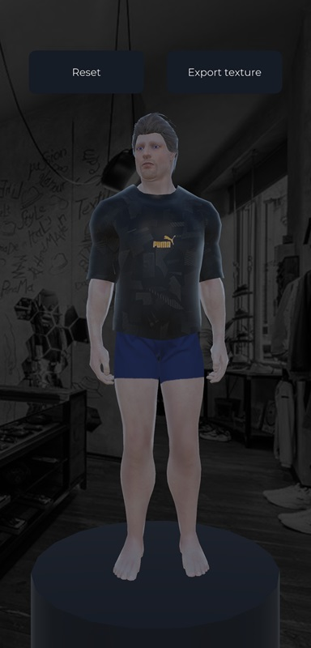
  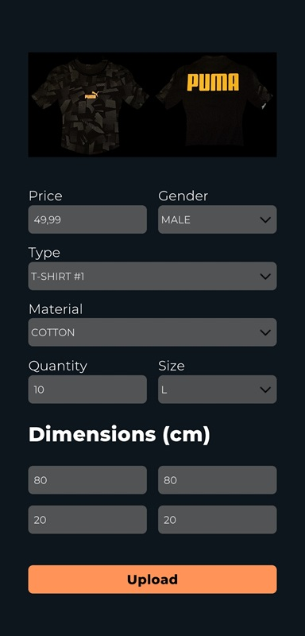
</p>

*Front and back acquisition, avatar preview and garment upload.*

### Artificial Intelligence and Computer Vision

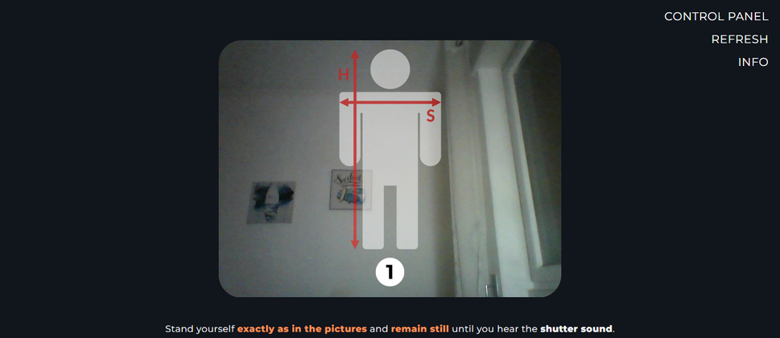

*Camera-based body acquisition with positioning instructions.*

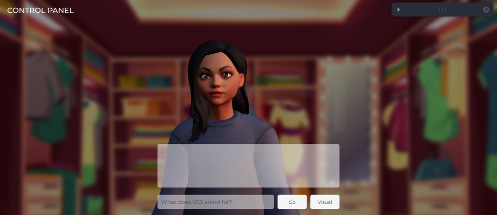

*Optional animated virtual assistant, shown in the academic interface; see [Optional Virtual Assistant](#optional-virtual-assistant) for provider requirements.*

## System Components

| Component | Responsibility | Technologies |
| --- | --- | --- |
| VCS desktop application | 3D store, avatars, clothing catalog and virtual fitting | Unity 2021.3.12f1, C#, UMA |
| Pulse Android application | Photograph garment sides and prepare/upload their textures | Unity, C#, Android |
| Web client | Merchant administration, clothing catalog, body acquisition, optional assistant | React, Three.js, TensorFlow.js |
| Web server | Accounts, authentication, catalog API, event delivery and image/regression integration | Node.js, Express, WebSocket, Mongoose |
| Python modules | Body-measurement regression, normalization and SVD | NumPy, scikit-learn, Matplotlib, Pillow |
| AssetBundleBuilder | Optional asset-bundle workflow for the selected Unity build target | Unity Editor |

### Architecture

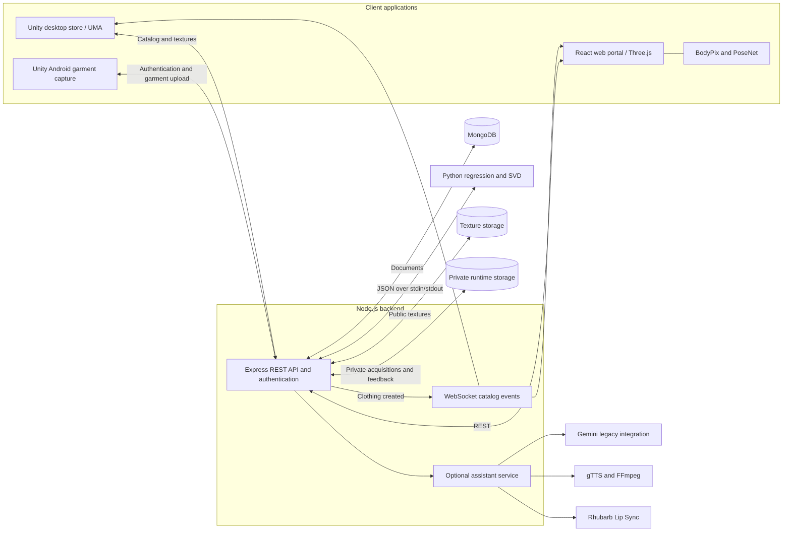

The backend stores clothing metadata in MongoDB and serves uploaded textures from a local runtime directory. New clothing events are broadcast to subscribed clients; the WebSocket does not relay arbitrary incoming client messages. The browser image-acquisition flow uses segmentation/landmark detection and a regression model to estimate body measurements. **Unreviewed measurement feedback is collected for offline evaluation and does not automatically alter global regression parameters.**

### Garment Digitization Workflow

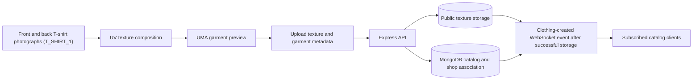

The Android application uses a predefined UMA-compatible T-shirt model rather than reconstructing a new mesh. The UV-mask preparation below is documented in the academic feasibility study; it is not a separate runtime AI model. The current clothing model supports `T_SHIRT_1`.

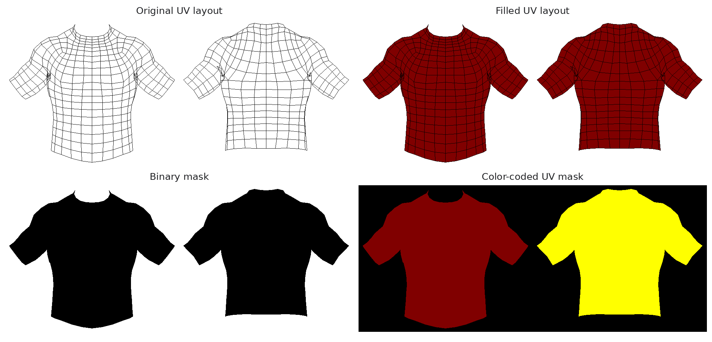

*Four stages of T-shirt UV mask preparation in the academic feasibility study.*

The academic report (Figure 4.2) also compares the estimated server storage required by complete 3D models and individual UV textures. With the assumptions of **10 MB per model** and **0.36 MB per texture**, 300 garment uploads would require approximately **3,000 MB** and **108 MB**, respectively. This is an illustrative storage estimate from the original design analysis, not a measured benchmark; it excludes other application data and the shared base model.

<p align="center">
  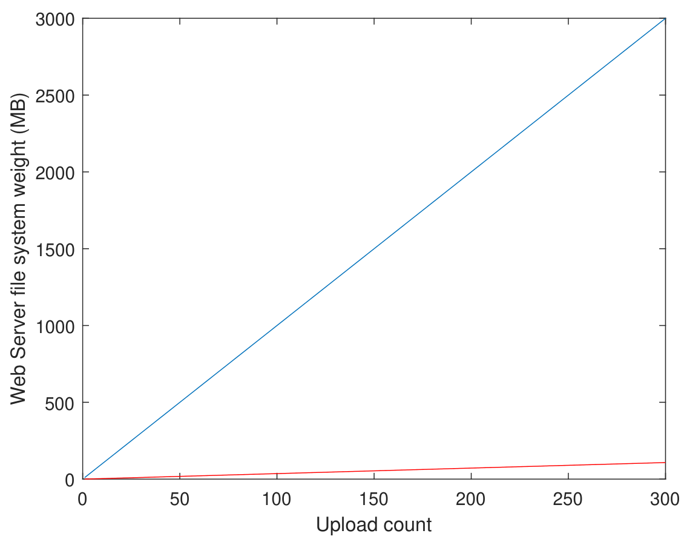
</p>

*Blue: complete 3D models. Red: UV textures applied to a shared base model.*

### Body Measurement Estimation Workflow

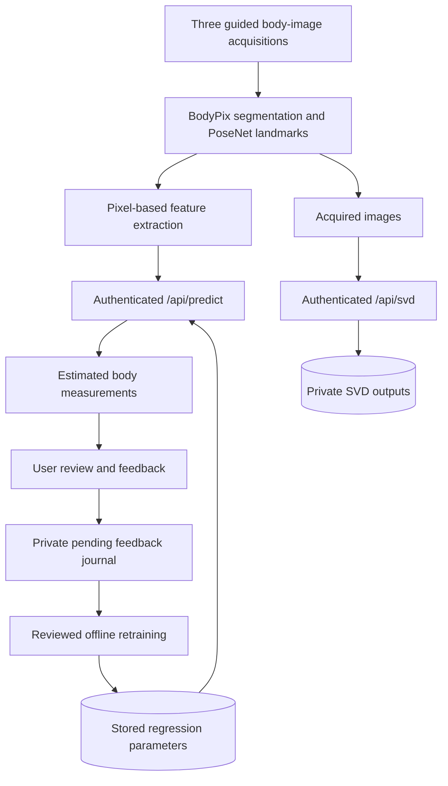

Regression and SVD are separate backend operations: SVD processing of the acquired images is not a prerequisite for measurement prediction. The feedback review and retraining procedure is described in [Feedback Handling](#feedback-handling).

<p align="center">
  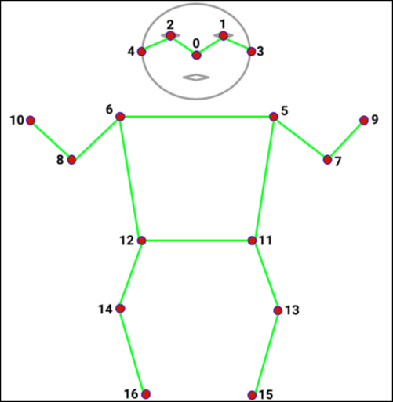
</p>

*Illustrative pose-landmark diagram from the academic report (Figure 7.14). Limb lengths are estimated from the detected joint coordinates before regression; the diagram uses zero-based landmark indices.*

## Repository Structure

```text
PYTHON/  # Standalone regression and SVD experiments
UNITY SOFTWARE/
  VCS - Virtual Clothing Shop/  # Desktop Unity project
  pulse/  # Android Unity project
  AssetBundleBuilder/  # Unity asset-bundle utility
WEBSITE/
  client/  # React application
  server/
    controllers/ models/  # Express/Mongoose application code
    routes/  # Public and authenticated endpoints
    python/  # Python processing bridge
    scripts/  # Local administration and regression commands
    MACHINE_LEARNING_DATASETS/  # Example numerical regression CSV
    tests/  # Backend tests
requirements.txt  # Python dependency manifest
tests/  # Python regression/SVD checks
docs/  # Academic documents and UI illustrations
```

Unity projects use `Assets/` (including `.meta` files), `Packages/`, and `ProjectSettings/`. Keep these three folders together when transferring each project. Unity regenerates its `Library/`, caches, and installed packages locally. The standalone `AssetBundleBuilder` project contains its own source `Assets/` directory.

## Getting Started

### Prerequisites

- **Unity 2021.3.12f1** for the supplied Unity project configurations. Android compilation additionally needs Android Build Support, Android SDK, NDK and JDK for that Unity version.
- **Node.js 20 or 22**, with npm and the supplied `package-lock.json` files (Node.js 22 recommended).
- A local or managed **MongoDB** instance.
- **Python 3** with the packages in `requirements.txt` for the regression and SVD components. Set `PYTHON_EXECUTABLE` to the same interpreter used to install these dependencies.
- An SMTP-capable email account for confirmation/recovery; use private credentials, never commit them.
- For the **optional** virtual assistant: a personal Google Gemini API key, a model compatible with the installed Gemini SDK, outbound internet access for speech synthesis, and the Rhubarb Lip Sync executable. FFmpeg is provided by the npm dependency `@ffmpeg-installer/ffmpeg` on supported platforms.

### Backend Setup

Install Python dependencies from the repository root. Use a dedicated virtual environment and ensure the backend uses that same interpreter.

**Linux/macOS (Bash):**

```bash
python3 -m venv .venv
source .venv/bin/activate
python -m pip install -r requirements.txt
cd WEBSITE/server
cp .env.example .env
```

**Windows (PowerShell):**

```powershell
py -3 -m venv .venv
.\.venv\Scripts\Activate.ps1
python -m pip install -r requirements.txt
Set-Location WEBSITE/server
Copy-Item .env.example .env
```

Edit the private `WEBSITE/server/.env` and provide `MONGODB_URI`, **four distinct strong authentication/session secrets**, and the SMTP credentials for sign-up and password recovery. For the backend, set `PYTHON_EXECUTABLE` relative to `WEBSITE/server` (for example, `../../.venv/bin/python` on Linux/macOS or `..\..\.venv\Scripts\python.exe` on Windows), or use the absolute interpreter path. Do not publish the populated `.env`.

From `WEBSITE/server`, with MongoDB already running:

```bash
npm ci
npm run regression:init -- --confirm
npm start
```

The API uses `http://localhost:3000` and the catalog-event WebSocket uses `ws://localhost:3002` by default. `regression:init` fits and inserts **nine** regression models from `MACHINE_LEARNING_DATASETS/human.csv`, preserving existing models. It does not create users, shops or a default password.

Register an account through the web application and confirm its email. To grant administrator privileges to an existing verified account, from `WEBSITE/server` run:

```bash
npm run admin:grant -- admin@example.com --confirm
```

Replace the sample address with that user's email. No public administrator-promotion endpoint is exposed.

#### Feedback Handling

Authenticated feedback submitted to `/api/trainingByFeedback` is validated and stored privately in `WEBSITE/server/pulse_cloud_storage/feedback/pending.jsonl`. Pending observations do **not** modify shared regression coefficients. Review the records and stop the API before applying them:

```bash
# Run from WEBSITE/server, after reviewing pending.jsonl:
npm run regression:feedback-apply -- --confirm
```

Approved feedback is retained in `WEBSITE/server/pulse_cloud_storage/feedback/approved.jsonl` and **included cumulatively in subsequent training runs**, alongside the baseline CSV. Do not edit or publish the approved journal as an ordinary code file: it can contain body measurements and user identifiers. Back up the journal before replacing the MongoDB database; the models can be reconstructed by applying the reviewed data again. The optional `FEEDBACK_DATASET_PATH` in the server environment selects a private baseline CSV when needed.

### Frontend Setup

Open a second terminal in the repository root (the backend runs in its own terminal).

```bash
cd WEBSITE/client
cp .env.example .env  # PowerShell: Copy-Item .env.example .env
# Ensure the API/WebSocket URLs target the configured backend.
npm ci --legacy-peer-deps  # Required by the react-sound/React peer-dependency ranges.
PORT=3001 npm start
```

On Windows PowerShell start the React development server with `$env:PORT=3001; npm start` instead of the POSIX `PORT=3001 npm start` form. The backend's example CORS configuration allows `http://localhost:3001`. Run React on port 3001 and Express on port 3000, and keep `REACT_APP_API_BASE_URL` and `REACT_APP_SOCKET_URL` consistent with the backend. Environment variables beginning with `REACT_APP_` are exposed to the browser; do not put secrets in the client environment.

## Optional Virtual Assistant

The assistant uses a **legacy Gemini integration** (`@google/generative-ai` and the `gemini-pro` default model), written when those interfaces were supported. **`gemini-pro` is now retired**, and the SDK is no longer the recommended Google client. A valid key by itself therefore does not make the default model operational. The implementation is kept in its original SDK family. `GOOGLE_MODEL` in `WEBSITE/server/.env` can select a different model only if that model is supported by the installed SDK and the provider API. A future provider change may require code updates.

1. Obtain your **own** Gemini API key and set `GOOGLE_API_KEY` in the **server** `.env`. No key is distributed. The server example also exposes `GOOGLE_MODEL=gemini-pro` so the existing default is explicit.
2. Install [Rhubarb Lip Sync](https://github.com/DanielSWolf/rhubarb-lip-sync/releases) for your operating system. Make the `rhubarb` executable discoverable in the **PATH inherited by the Node.js process**. Before starting `npm start`, run `rhubarb --help` in the same terminal to verify that Node.js can launch it. Alternatively, set `RHUBARB_EXECUTABLE` in the server `.env` to the executable's absolute path (for example, the Windows `.exe` path). Restart the backend after changing PATH or `.env`.
3. Install server packages with `npm ci`. `@ffmpeg-installer/ffmpeg` supplies FFmpeg for supported platforms, while the application uses the **legacy** `fluent-ffmpeg` wrapper to convert speech audio to WAV. The `gtts` library uses an external Google speech service; an internet connection is required and its availability may vary.
4. Start MongoDB, the API and the React client, sign in to an account and open the virtual-assistant screen. Text responses, WAV audio and Rhubarb mouth-cue JSON are returned by the backend; the frontend renders the supplied avatar and animations.

Keep provider credentials in the private server environment, never in `WEBSITE/client/.env`. The voice, model and lip-sync features depend on external services and executable availability; failures return a controlled error to the client.

## Unity and Android Builds

Open each Unity project with **Unity 2021.3.12f1**, preserving its `Assets/` folder and accompanying `.meta` files. Use Unity's Package Manager to resolve packages specified by `Packages/manifest.json`. The `Library/` directory is regenerated locally. Open the desired scenes from `Assets/` and choose the appropriate build target.

For Android, install Android Build Support with its SDK, NDK and JDK, switch the platform to Android in Build Settings and compile from the Unity Editor. **No APK is bundled, distributed or served by this repository.** The project does not contain a signing keystore; configure your own if a signed release is needed. The separate AssetBundleBuilder uses the build target selected in the Unity Editor.

Unity asset packages and third-party resources must be used in accordance with their licenses.

## Python Experiments and Research Data

- The two interactive regression programs in `PYTHON/` use their local `human.csv`, print predictions and save fitted coefficients to a local `trained_parameters.json` file. These standalone scripts do not change the server's MongoDB models; do not include generated coefficients in the published source archive unless you intend to publish them.
- `PYTHON/SVD/svd.py` supports interactive singular-value experiments on locally supplied images. See [`PYTHON/SVD/README.md`](PYTHON/SVD/README.md) for folder layout.
- The web backend uses `WEBSITE/server/python/script.py` to estimate body measurements, fit regression parameters and process authenticated PNG uploads by SVD.

The following historical plots from the academic report illustrate the singular-value spectrum and cumulative energy used to investigate image compression; they are not newly measured results.

<p align="center">
  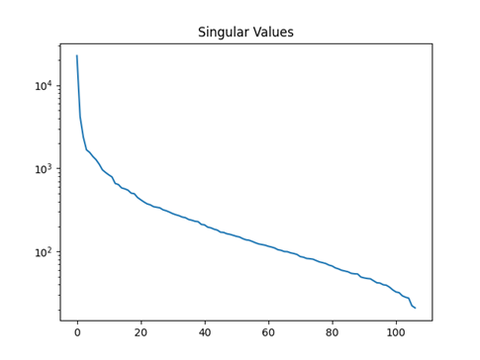
  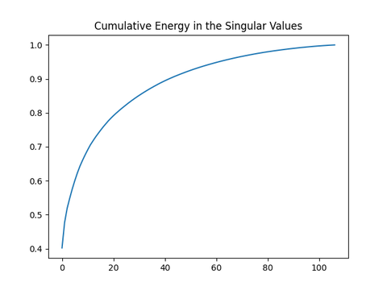
</p>

*Historical singular-value spectrum and cumulative energy, respectively.*

**Photographic body-measurement samples and their processed derivatives are not distributed** with the source code. To reproduce photographic experiments, provide images you have lawful access to and permission to process. The academic research references the [Body Measurements Dataset](https://huggingface.co/datasets/UniqueData/body-measurements-dataset); consult its current license and any source-specific restrictions before acquiring or sharing materials. The included numerical CSV reconstructs the prototype regression starting point; it is not a substitute for the full photographic dataset. Tests use synthetic images and measurements.

## Tests

```bash
# From the repository root:
python -m unittest discover -s tests -v
find WEBSITE/server -path '*/node_modules' -prune -o -name '*.js' -exec node --check '{}' ';'
cd WEBSITE/server && npm test
# After installing the React dependencies:
cd ../client && npm run build
```

On Windows PowerShell, replace the `find` command above with `Get-ChildItem WEBSITE/server -Recurse -Filter *.js | Where-Object { $_.FullName -notmatch 'node_modules' } | ForEach-Object { node --check $_.FullName }`. The supplied tests cover numerical regressions, SVD output, backend input validation, and the feedback journal. Run them after installation when working on the project.

## Security and External Resources

- Treat `.env`, authentication secrets, Android signing keys, user photographs, feedback journals and runtime database files as **private local data**. Do not include them in the source files you publish. Use new credentials for each deployment.
- The sign-in form may remember the email address but **does not store the password**.
- Body measurements sent as feedback require deliberate review before retraining global models. Runtime data must be protected and removed according to the application's retention policy.
- The runtime texture directory is `WEBSITE/server/pulse_cloud_storage/T_SHIRT_TEXTURES/`; manage the permissions and storage lifecycle of uploaded assets.
- This is a **research prototype**, not a production-hardened commerce service. A basic per-process rate limiter protects selected routes; a public deployment additionally needs HTTPS/WSS, a shared anti-abuse layer and operational monitoring.
- Some Unity and 3D resources originate from external ecosystems, including [UMA](https://github.com/umasteeringgroup/content-pack) and [Ready Player Me](https://readyplayer.me/). Respect applicable asset licenses and attribution requirements; dependency installation does not grant permission to republish arbitrary third-party asset libraries.

## Documentation

The original VCS project was also the subject of **[Cosimo Curri](https://github.com/cosimo-curri)'s bachelor's thesis** (Academic Year **2022–2023**), corresponding to the undergraduate course and module described in the project background:

- [Bachelor's thesis — VCS — Virtual Clothing Shop (Italian, PDF)](docs/vcs-bachelor-thesis-it.pdf). Original title: *Elevare l’innovazione nel settore della moda: studio del progresso tecnologico di un ambiente e-commerce in realtà aumentata*. The thesis is **written in Italian** and focuses on the original VCS architecture, virtual store, web portal, design process and proposed improvements. It documents an earlier stage of the project rather than all features subsequently introduced in Pulse.
- [Statistical and Mathematical Methods for Artificial Intelligence — academic report (English, PDF)](docs/pulse-academic-report.pdf). Covers the later Pulse evolution, software architecture, computer-vision experiments and AI-related investigations.

Both documents are academic research materials, distinct from the installation instructions in this README.

## Contributors

- [Cosimo Curri](https://github.com/cosimo-curri)
- [Giovanni Nardelli](https://github.com/narGiovanni)
- [Vincenzo Vitale](https://github.com/Elativee)
- [Selma Jawhari Idrissi](https://github.com/selmaidrissi16-01)

## License and Third-Party Materials

The original project code is licensed under the [MIT License](LICENSE). Third-party materials remain subject to their respective licenses and terms.
